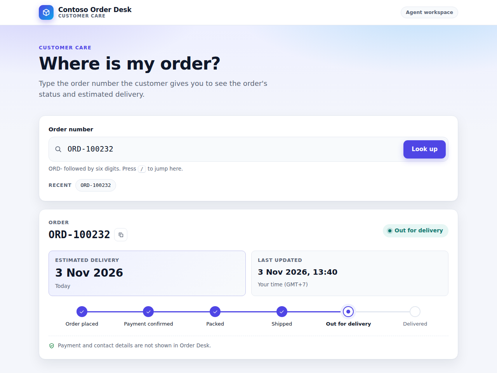
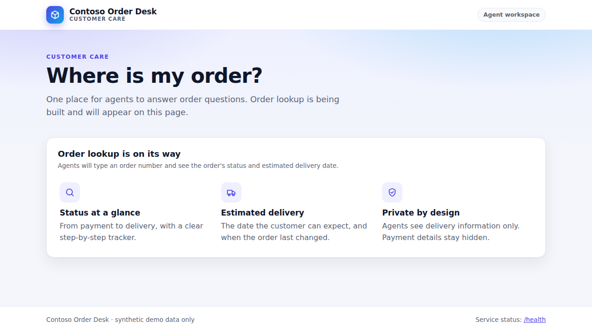
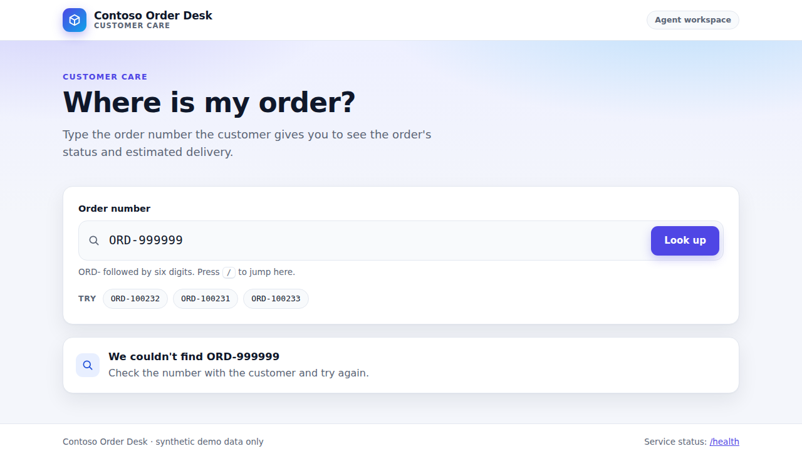
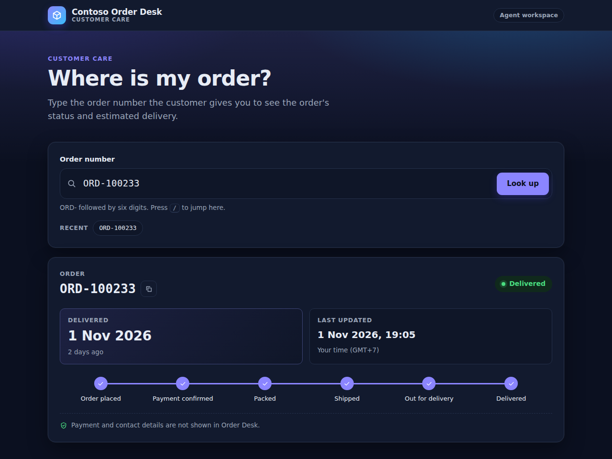

# Contoso Order Desk · live demo kit

[](https://github.com/ibranibeny/contoso-order-desk/actions/workflows/ci-cd.yml)

Starter repository for **Session 5 of the Contoso × GitHub workshop: "From business requirement to production"**.
You run the demo for real with it: a business requirement becomes an issue, Copilot builds the API (VS Code agent mode) and the page (Copilot cloud agent) in parallel, Copilot and a human review, CodeQL with Copilot Autofix and dependency review gate the merge, and GitHub Actions deploys to Azure App Service with an approval and OpenID Connect.

- **Step-by-step guide:** [docs/LIVE-DEMO-GUIDE.md](docs/LIVE-DEMO-GUIDE.md) (setup, run of show, fallbacks, reset, troubleshooting)
- **Copy-paste prompts:** [docs/PROMPTS.md](docs/PROMPTS.md)
- **What it looks like when it works:** the simulated [demo replay](https://ibranibeny.github.io/contoso-github-ai-workshop/replay.html?demo=live-demo) and the [workshop site](https://ibranibeny.github.io/contoso-github-ai-workshop/05-live-demo.html)



| Before the demo (main) | Unknown order | Dark mode |
|---|---|---|
|  |  |  |

Screenshots are taken automatically from the `solution` branch, with the demo day set to 3 November 2026.

## Run it in four steps

1. **Create your copy:** **Use this template → Create a new repository**, and tick **Include all branches**.
2. **Configure GitHub:** `scripts/github-setup.sh` (settings, security, environment, ruleset, project). One account by default: you approve the deployment yourself. With a second person: `APPROVER=<second-person> scripts/github-setup.sh`.
3. **Create Azure:** `scripts/azure-setup.sh` in Azure Cloud Shell (App Service, managed identity with OIDC, secrets), then approve the first deployment (you, or the approver).
4. **Before each session:** `scripts/prepare-security-prs.sh`, then `scripts/preflight.sh`. Afterwards: `scripts/reset-demo.sh`.

Details, licences and the two-person setup are in the [guide](docs/LIVE-DEMO-GUIDE.md#1-what-you-need).

## Try the app locally

```bash
npm ci
npm test
npm start                    # http://localhost:3000 shows the placeholder page (the demo starts here)
git switch solution && npm start   # the finished Order Desk: try ORD-100232, ORD-999999 and 12345
```

Node.js 24 and Express 5. Tests use the built-in `node --test` runner.

## Branches

| Branch | What it is | Used in |
|---|---|---|
| `main` | The starting point: health endpoint, synthetic orders, design system, placeholder page, Copilot instructions, workflows | Whole demo (tag `demo-start`) |
| `fallback/order-lookup-api` | A finished `GET /api/orders/:orderId` with tests | Act 2, if agent mode stalls |
| `fallback/agent-lookup-page` | A finished lookup page with tests | Act 3, if the cloud agent is not ready |
| `solution` | Both, merged: what main looks like after the demo | Rehearsal reference, screenshots |
| `demo/not-found-message` | A deliberately unsafe handler (reflected XSS) | Act 4: CodeQL and Copilot Autofix. Never merge |
| `demo/add-date-helper` | Adds `lodash@4.17.15`, a version with published advisories | Act 4: dependency review. Never merge |

## Scripts

| Script | When | What it does |
|---|---|---|
| `scripts/github-setup.sh` | Once | Repository settings, approver access (two people only), project, CODEOWNERS, security features, `production` environment, ruleset, `demo-start` tag |
| `scripts/azure-setup.sh` | Once (Cloud Shell) | App Service (Linux, Node.js 24), Application Insights, user-assigned managed identity with a federated credential for the `production` environment, environment secrets, first deployment |
| `scripts/prepare-security-prs.sh` | 60 min before | Opens the two security pull requests from the current main |
| `scripts/preflight.sh` | 30 min before | Read-only readiness check |
| `scripts/create-demo-issues.sh` | Fallback | Creates the feature issue and its three sub-issues if creating issues with Copilot is unavailable |
| `scripts/push-protection-demo.sh` | Optional | Shows push protection blocking a made-up "Contoso demo token" (organization with a custom pattern) |
| `scripts/reset-demo.sh` | After each run | Closes pull requests and issues, deletes demo branches, moves main back to `demo-start` |
| `scripts/cleanup-azure.sh` | After the workshop | Deletes the Azure resource group and the Azure settings in GitHub |
| `npm run seed -- --date YYYY-MM-DD` | Any time | Regenerates the synthetic orders relative to a demo day |

## What's inside

```text
.github/
  copilot-instructions.md          Contoso's rules for every Copilot surface
  instructions/tests.instructions.md
  agents/test-coverage-improver.agent.md
  ISSUE_TEMPLATE/feature-request.yml
  CODEOWNERS, dependabot.yml, pull_request_template.md
  workflows/ci-cd.yml              build + test, then deploy with approval and OIDC
  workflows/dependency-review.yml
  workflows/copilot-setup-steps.yml
data/orders.json                   40 synthetic e-commerce orders (example.com addresses, 555 phone numbers)
public/                            design system (styles.css) and the placeholder page
scripts/                           setup, demo and reset scripts
src/, test/                        Express 5 app and tests
docs/                              guide, prompts, screenshots
```

## Data and privacy

All orders, names, emails, phone numbers and card digits are generated by `scripts/seed-orders.mjs` and are fictitious. Contoso, Northwind and Fabrikam are fictitious companies used in Microsoft examples.

## Status

Before publishing, every branch was installed and tested on a GitHub-hosted runner with Node.js 24 and Express 5: `main` (1 test), `fallback/order-lookup-api` (8), `fallback/agent-lookup-page` (10), `solution` (18) and both demo branches (1 each), all passing. The finished app was started on the runner and checked in headless Chrome, which also took the screenshots above. CI/CD runs on main and on every pull request.

The setup scripts were checked end to end against stand-in `gh` and `az` commands, not against a real organization and subscription, and the deploy job has not yet run against Azure: run them in a rehearsal first. See [what has been tested](docs/LIVE-DEMO-GUIDE.md#7-what-has-been-tested-and-what-you-must-check-in-rehearsal).
